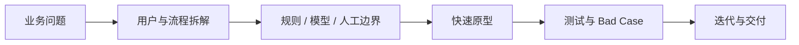

# 赖韦寒雨｜AI 产品经理

把复杂业务拆成规则、模型与人工协同流程，并用 AI Coding 快速完成可验证的产品原型。

*AI Product Manager focused on workflow design, RAG, evaluation, human-in-the-loop systems, and rapid prototyping.*

## 我在做什么

- 从真实业务问题出发，识别哪些环节适合规则、模型或人工判断
- 设计 AI Workflow、RAG、Prompt、Evaluation 与 Bad Case 迭代机制
- 用 Python、TypeScript 和 AI Coding 把方案快速做成可交互 Demo
- 关注解释性、可控性和人工确认，不把“接入模型”等同于“问题已解决”

## 代表作品

| 项目 | 解决的问题 | 能力体现 |
| --- | --- | --- |
| [DormBuild](https://github.com/hanyu366/DormBuild) | 将宿舍费用、值日、公约、投票和沟通收敛到统一工作台 | B 端流程抽象、全栈原型、AI 事务入口 |
| [AI 机票决策助手](https://github.com/hanyu366/meituan-html-demo) | 帮助用户理解票面价格之外的行李、退改、时间和机场成本 | 决策型产品设计、解释型推荐、交互原型 |
| [Zotero AI Preread](https://github.com/hanyu366/zotero-ai-preread) | 围绕研究问题生成可审查的论文预读批注计划 | 科研工作流、结构化输出、人机确认边界 |
| [Week Work Report](https://github.com/hanyu366/week-work-report) | 把组会 PPT 转为经确认的中英文科研周报和 Word 文档 | 多阶段 Workflow、证据约束、格式化交付 |

## 产品与技术能力

| 方向 | 能力与工具 |
| --- | --- |
| AI 产品 | LLM 应用设计、RAG、Prompt / Workflow、AI Evaluation、Human-in-the-loop、Bad Case 分析 |
| 产品设计 | 用户研究、需求分析、复杂业务抽象、B 端流程、PRD、原型与指标设计 |
| 快速验证 | Python、TypeScript、React、API、数据库、AI Coding |
| 工作原则 | 证据优先、边界清晰、先验证后扩展、保留人工确认 |

## 项目组合

- **协作型产品**：DormBuild 验证多人事务、状态流转与通知机制
- **决策型产品**：AI 机票决策助手验证推荐解释与多方案比较
- **知识工作流**：Zotero AI Preread 验证从非结构化文档到可审查输出
- **Agent 工作流**：Week Work Report 验证分阶段生成、人工确认与格式化交付

> 这里展示的是可阅读、可运行或可验证的个人项目。仓库 README 会说明真实功能、运行方式与当前边界。
