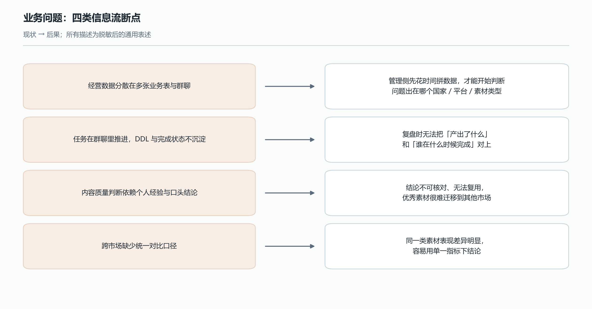
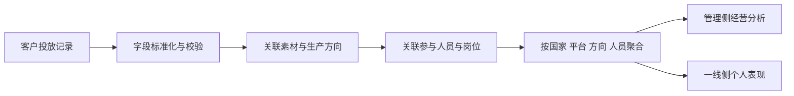

# 素材经营与生产协同平台

## 从 0 到 1 搭建多角色业务工作台

**优矩互动 · AI 产品经理实习 · 2026.05—2026.08 · B 端平台建设**

我从外部投放数据难以支撑内部经营分析的问题出发，梳理素材、人员、投放记录与任务的关系，从 0 到 1 推进管理侧与一线侧工作台设计和交付。平台将经营分析、个人表现、任务与复盘集中到日常工作流程中，覆盖 40+ 人，活跃人数按一个月周期统计；据管理者口述估算，人均每周减少约 4–5 小时数据整理与查找工作。

## 1. 起点：外部投放结果，需要转成内部经营信息

团队覆盖多个国家与投放平台，经营数据、人员信息和生产任务分散在十余张业务表与群聊中。

客户提供的投放记录能反映素材表现，包括消耗、在投数量和转化等信息。内部团队还需要知道：这些结果对应哪个生产方向、由哪些岗位和人员共同完成，以及下一轮应该如何安排生产。

我通过管理者与一线人员沟通、团队周会观察，梳理出两类不同的使用需求：

| 用户 | 工作目标 | 原有阻碍 |
| --- | --- | --- |
| 管理者 | 判断经营变化、定位素材与相关人员、安排资源和任务 | 跨表整理耗时，经营结果与生产人员、任务缺少直接关联 |
| 编导、摄像、后期等一线人员 | 查看自己的表现、处理待办、学习与复用素材经验 | 个人数据、任务和复盘分散，需要反复查表与翻群聊 |



我据此将平台目标确定为：**以统一的数据关系，支撑管理者的经营决策与一线人员的生产执行。**

## 2. 从 0 到 1：先理清业务对象，再确定建设范围

我主要承担需求梳理、业务对象与指标口径设计、双端工作台方案，并推进实现、业务验证和上线迭代。

其中的核心难点，是将不同角色的数据需求和协作流程组织到同一套产品模型中：一条素材由多个岗位共同完成，又可能在不同平台产生投放记录；管理者需要整体视角，一线人员需要与自己有关的信息。

我围绕素材、人员、投放结果与任务建立关联，再分别梳理管理者的决策路径和一线人员的执行路径。

建设范围按业务依赖安排：先保障数据获取、指标口径和经营总览，再完善个人数据、任务协同、复盘与素材复用。

## 3. 数据转接：把投放明细关联到素材与人员

数据进入平台，需要经过标准化、业务关联和指标聚合三个环节。

| 环节 | 我的处理 | 支撑的业务使用 |
| --- | --- | --- |
| 字段标准化 | 按既定命名规则拆解人员、素材方向与场景信息，检查字段是否合法 | 统一后续筛选与统计的基础 |
| 业务关联 | 通过素材 ID 及映射关系连接投放记录、素材、国家、生产方向和参与人员 | 从经营变化追到具体素材与相关岗位 |
| 指标聚合 | 保留各平台明细，再按经营分析需要汇总 | 同时查看整体表现与具体明细 |



一条素材可能由编导、摄像、后期等多人共同完成，素材与人员需要按岗位建立关系；同一素材在多个平台投放时，也要保留投放明细。人员归属与投放记录分别处理，避免关联后重复计算，影响经营与人员分析。

## 4. 双端工作台：同一数据基础，不同的使用路径

| 角色入口 | 主要信息 | 核心操作 |
| --- | --- | --- |
| 管理侧 | 经营总览、趋势、人员表现与素材明细 | 按维度下钻、定位问题、分配任务、编辑与发布复盘 |
| 一线侧 | 个人表现、待办、相关复盘与优秀素材 | 查看自己的数据、完成任务、学习案例、承接复刻 |

管理者按照“整体经营—国家 / 平台 / 方向—素材与人员”的顺序定位问题；一线人员从自己的工作入口查看数据和任务，减少查找无关信息。

例如，排查整体消耗下降时，可以先确认统计周期与数据是否及时，再定位变化来自哪个国家、平台或方向，继续查看相关素材和人员。

## 5. 任务协同：将经营判断接到生产安排

平台把分析后的动作连接到任务、复盘和素材复用中：管理者定位问题后组织生产安排，一线人员在工作台接收相关信息、执行制作与优化，再回看下一轮结果。

```text
外部投放结果 → 经营总览与下钻 → 定位素材、方向与人员
  → 发布复盘、分配任务或安排复刻
  → 一线查看与执行 → 新素材投放 → 结果回流
```

任务中心最初只记录大任务的完成状态，员工知道总截止时间，却看不清每天具体要完成哪些工作，待办容易拖延，也有遗漏或遗忘的风险。脚本撰写和视频拍摄各有截止时间，拍摄还涉及演员档期，只展示总任务不足以支持实际协同。

我据此将脚本、拍摄等中间节点组织为可执行的小任务，调整页面版式和交互，并推进相应数据接入逻辑的修改。员工完成小任务后勾选即可，无需额外填写过程记录；调整工作主要落在产品呈现与实现逻辑上。

调整后，员工可以看清每天的工作量及未完成事项，任务中心也能对应真实生产节点，回应待办处理不及时和事项遗漏的协同问题。这次迭代让我将判断标准落到“能否帮助员工完成当天的工作”，并据此调整任务的展示与状态组织方式。

素材诊断作为嵌入模块提供复盘支持，其工作流、问题排序与评测在[多模态 AI 素材诊断专题](06_多模态AI素材诊断.md)中单独展开。

## 6. 产品取舍：保留数据基础，增加角色工作台

当时也考虑过继续使用多维表格或独立 BI。随着需求拆解，团队需要将人员表现、素材视频、任务分配、复盘发布与素材复刻连接到日常使用路径中。

我选择保留已有数据基础，在上层搭建面向业务角色的工作台，优先满足高频关键链路，并控制自建平台的实现与维护范围。

## 7. 平台结果与后续迭代

| 结果 | 口径 |
| --- | --- |
| 覆盖 40+ 人并保持周期性活跃 | 活跃人数统计周期为一个月，包含管理、编导、摄像、后期等角色 |
| 管理者人均每周减少约 4–5 小时数据整理与查找工作 | 来自管理者对使用前后耗时的口述估算 |
| 公司 FDE AI 应用赛第 8 / 60 名 | 平台项目的内部比赛成绩 |

实习期间，我还在平台数据基础上探索了数据分析 Agent，支持管理者通过对话获取经营统计，并配置了指标口径知识库、需求澄清与“待确认”规则，以及数据库取数和计算脚本。

在一次周度统计任务中，Agent 根据报表样式，通过澄清明确数据归因延迟下的统计周期、周新增计算方式和素材去重口径，完成各国家本地拍摄与国内素材的对比表，**计算结果已核验正确**。后续重点减少重复澄清、复用已确认口径，并通过更多真实任务验证稳定性与使用效率。

平台后续也将继续完善数据更新与来源一致性检查，补充经营查看、任务处理和素材复用等功能的使用记录，并通过固定业务反馈机制明确迭代优先级。

[返回作品集首页](00_作品集首页.md) · [查看 AI 内容审核](05_AI内容审核系统.md)
