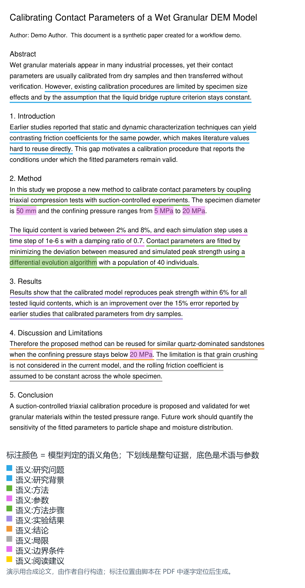

# Zotero 论文预读助手｜按研究目标定位原文并写回批注

**个人项目 · 独立设计与实现**

从自身科研阅读需求出发，我设计并打通了“明确阅读目标—AI 全文预读—筛选原文—写回 Zotero 批注”的工作流，帮助研究者带着当前问题回到原文核对。

## 1. 需求与选择

同一篇论文在文献调研、实验设计和写作阶段会被反复阅读，但每次关注的问题不同。我选择让预读结果直接回到 Zotero PDF，用户可以沿原文继续阅读、保留或修改批注，减少在独立报告与论文之间寻找对应位置的成本。

## 2. 已实现的流程

AI Agent 根据阅读目标理解全文、选择相关原文；程序验证原文并定位 PDF 坐标，再由 Zotero 插件写入原生批注并返回写入结果。整句下划线保留证据，术语和参数高亮便于定位。

目前支持按新任务再次预读、批注筛选与批量清理，以及将批注导出为 Markdown 和 AI 可读 JSON。

## 3. 批注展示

图中使用合成论文演示原生批注样式。

## 4. 当前阶段

已用于自己的科研阅读及课题组同学的初步使用。用户可以在 Zotero 中人工核对和修订；人工反馈的自动采集、回测与后续预读复用仍在完善。

[源码与安装说明](https://github.com/hanyu366/zotero-ai-preread/blob/81bd41224fd74cfe81fc6dc615d995542fd5a05f/README.md) · [AI 全文预读工作流](https://github.com/hanyu366/zotero-ai-preread/blob/81bd41224fd74cfe81fc6dc615d995542fd5a05f/skills/zotero-ai-preread/SKILL.md)

[返回作品集首页](00_作品集首页.md) · [查看 DormMate 产品案例](03_DormMate_AI.md)
