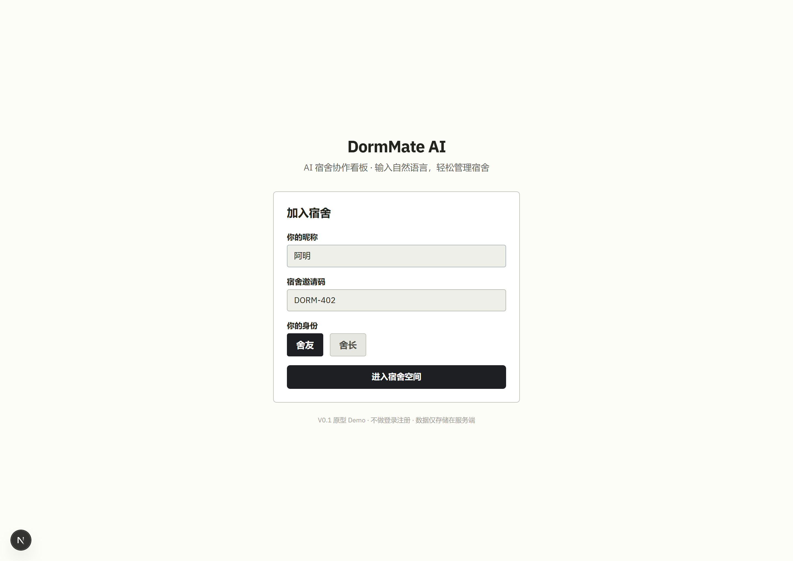
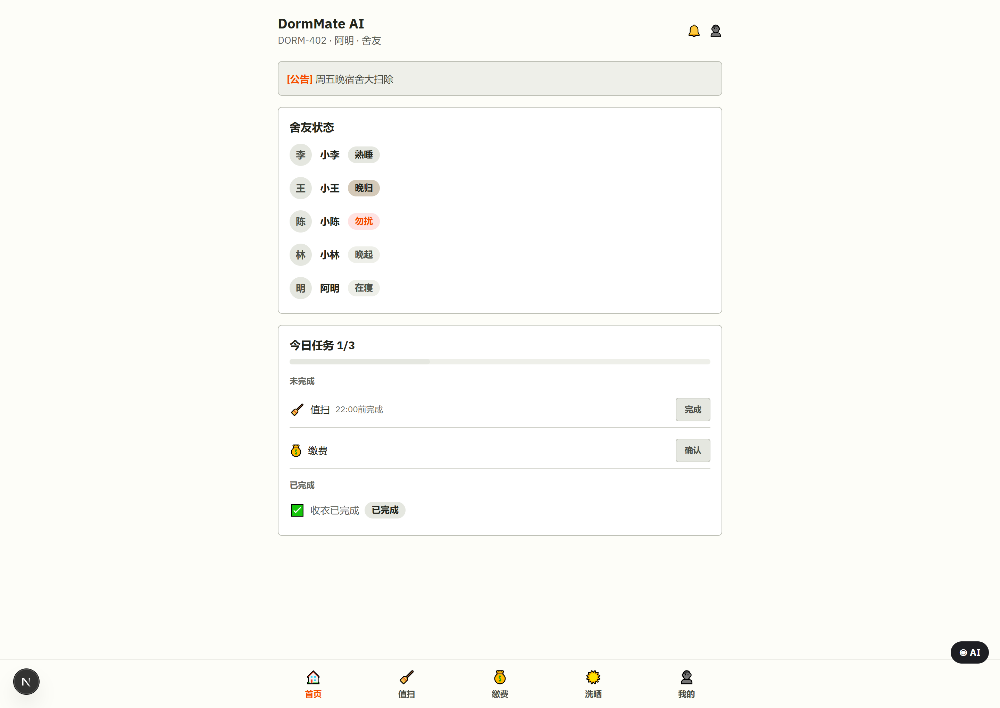
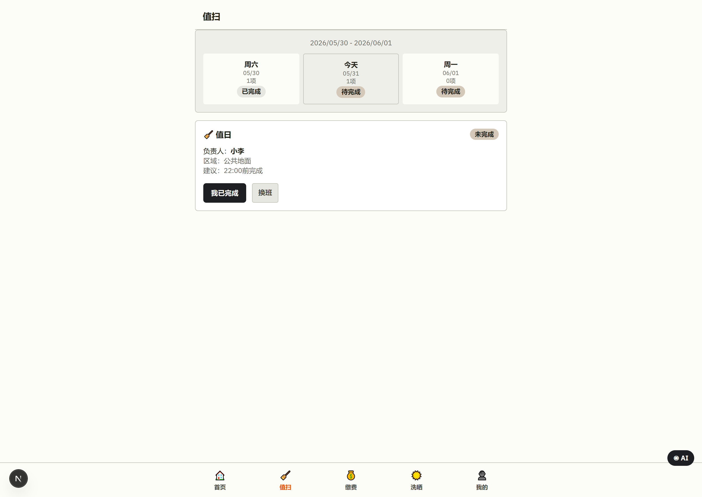
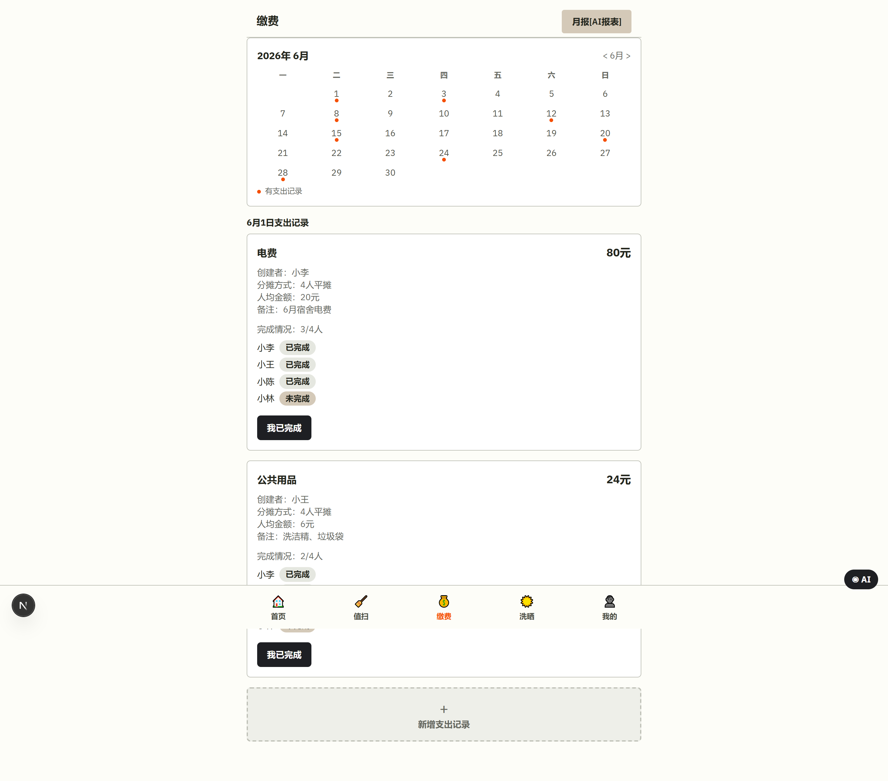
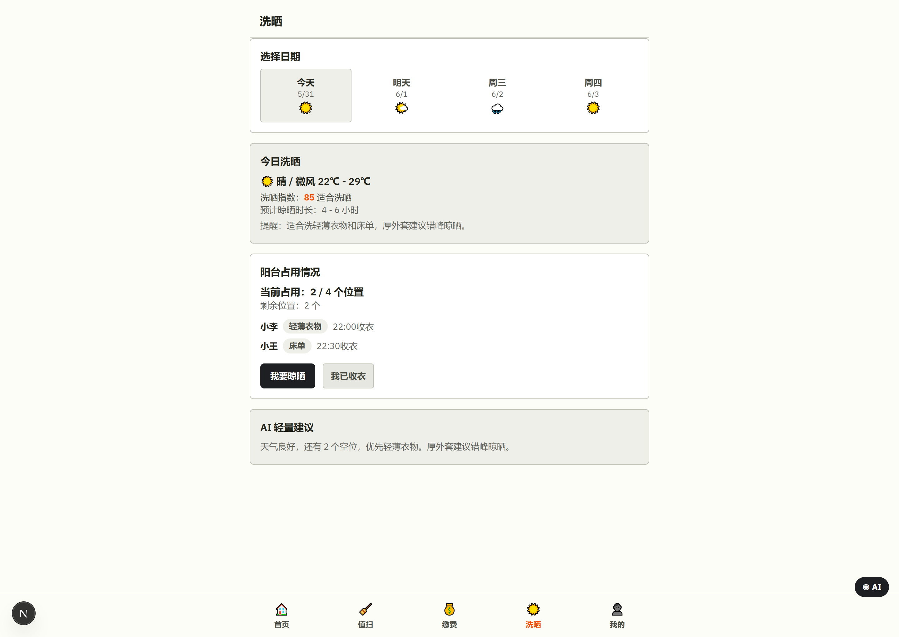

# DormMate AI｜从宿舍协作需求到可运行产品原型

**个人项目 · 3 人团队 · 6 小时 Vibe Coding 比赛 Demo**

DormMate AI 是面向大学生宿舍的协作助手，通过“共享看板＋AI 对话”集中管理值日、公共费用和成员状态。用户可以查看宿舍事务，也可以用自然语言调用程序、修改状态，结果回到看板。团队在六小时内完成可运行 Demo，真实接入 DeepSeek 模型，获武汉大学自强 Vibe Coding 挑战赛「潜力新锐奖」。

## 1. 背景：宿舍事务有记录，却缺少共享状态

值日、公共费用与作息变化通常通过群聊沟通。消息容易被覆盖，成员需要反复确认谁值日、费用是否结清、哪些事项仍待处理。临时换班或新增支出后，也缺少一个大家都能随时查看的当前状态。

我们据此选择宿舍协作场景。但独立应用如果要求成员频繁填表、切换页面，维护成本可能比群聊更高。因此，产品需要同时解决信息集中和操作便捷两个问题。

## 2. 方案与取舍：共享看板承接状态，AI 降低操作成本

六小时内，我们围绕值日、费用、成员状态与洗晒完成“共享看板＋AI 对话”的协作体验，并提供费用月报展示。

看板让成员快速看到当前安排与完成情况；AI 接入同一份状态，支持自然语言查询“今天谁值日”以及状态修改、记账等操作。核心自然语言操作真实接入 DeepSeek，结果继续回到看板。

这次取舍主要在账号、数据来源和部署方式上。在六小时限制下，我们优先用模拟成员和宿舍数据，在本地跑通“自然语言理解—程序操作—状态回写”，暂缓真实多账号登录、真实数据源接入和服务器部署，将时间集中到核心交互与执行逻辑。

| 模块 | 比赛版已实现的体验 |
| --- | --- |
| 值日 | 查看安排、标记完成与调整值日人 |
| 费用 | 查看与记录支出、分摊及完成状态 |
| 成员状态 | 查看、修改状态，并同步回到首页看板 |
| 洗晒 | 查看洗晒信息、登记晾晒和收衣、更新阳台占用 |
| 费用月报 | 展示费用结构、支出趋势与成员确认情况 |

比赛版使用模拟成员与宿舍数据，天气和月报采用预置演示内容。

## 3. 创新点：共享状态、对话操作、能力复用

- **共享状态**：将群聊中分散的事务转为共同可见、可更新的看板，减少反复确认。
- **对话操作**：用自然语言表达需求，直接触发程序操作并反馈状态变化。
- **能力复用**：将已有程序动作组织为 AI 可调用的能力，为扩展更多事务提供基础。

## 4. 团队协作：从共同设计到实现与演示

我负责推动团队确定立意、拆解需求、判断优先级，并推进方案落地。原型与 PRD 由团队共同完成，用来对齐页面需要呈现的信息、用户操作和状态变化，再衔接 UI 与程序实现。

| 环节 | 分工与衔接 |
| --- | --- |
| 需求与方案 | 我统筹需求拆解、方案和优先级，推动范围对齐 |
| PRD 与原型 | 团队共同完成，作为设计与实现的共同依据 |
| UI 与开发 | 队友负责 UI；我使用 Claude Code 完成程序和 AI 接口调用 |
| 测试与汇报 | 我继续负责程序实现与落地推进，队友承担后续测试及汇报 PPT |

这次协作需要把产品想法落实到可共同理解的页面和操作，再连接设计、开发、测试与汇报，确保六小时内形成可演示的产品。

## 5. UI 与原型：按进入宿舍后的使用顺序展示

以下按“加入宿舍—首页看板—值日—费用—洗晒”展示比赛版原型与演示界面。原型与 PRD 由团队共同完成，UI 由队友负责；账号与宿舍数据为模拟数据。

### 5.1 加入宿舍：进入共同的事务空间

通过昵称、邀请码与身份选择进入演示空间。此处展示的是原型入口，尚未实现多账号登录认证。

### 5.2 首页看板：先看成员状态和今日待办

首页汇总公告、舍友状态、待完成与已完成事项，成员可据此进入具体事务；右下角保留 AI 入口。

### 5.3 值日任务：明确日期、负责人和完成情况

上方按日期查看安排，下方展示负责人、负责区域与任务状态，并提供“我已完成”等操作入口。

### 5.4 费用分摊：共同核对支出与完成情况

通过日历定位支出记录，查看金额、分摊方式、人均金额及各成员完成状态，底部提供新增支出入口。

### 5.5 洗晒安排：结合天气和阳台占用作判断

页面依次展示日期天气、今日洗晒建议与阳台占用情况，并提供“我要晾晒”“我已收衣”入口。

## 6. 模型选型：从成本、响应与功能需求判断适配性

我们对比了小米 MiMo、DeepSeek 和 Kimi，从成本、响应速度、功能需求与输出风格判断适配性。当时试用中，DeepSeek 成本较低、响应较快，能够满足状态查询和操作理解等需求，因此选用 DeepSeek。

当时试用中，模型配合提示词与配置给出的回复较简洁，适合轻量宿舍事务。

## 7. 实现与交付：一句话修改今日状态

比赛版真实调用 DeepSeek，并已打通程序操作与状态回写。例如，用户可以表达：

> 帮我把今日状态修改为晚归。

AI 识别状态修改需求，由程序按昵称定位当前演示成员，将其状态更新为“晚归”，首页“舍友状态”随之变化。公开比赛版优先调用 DeepSeek，未配置密钥或模型调用失败时使用本地规则回退。

无相关记录时，空状态的提示方案为“目前没有相关数据，期待后续优化～”。

三人在六小时内完成可运行 Demo，并获「潜力新锐奖」。

## 8. 复盘：持续使用、真实协作与能力复用

### 8.1 验证持续使用价值：成员是否愿意更新，操作是否更省事

补齐多账号与必要权限后，计划邀请少量宿舍开展两周试用。试用前访谈成员，了解目前如何记录和确认事务；试用中结合操作日志、状态抽查与结束访谈，重点验证：

| 验证问题 | 指标与方法 |
| --- | --- |
| 成员是否持续维护 | 观察次周主动更新率：首周完成更新的成员中，次周仍主动更新的比例；访谈停止更新者，了解是否回到群聊及原因 |
| 看板是否保持可信 | 抽查事项，将看板与成员确认的实际状态对照，记录一致比例及未及时更新的原因 |
| 对话是否降低操作成本 | 让成员分别用对话和页面完成同类状态修改，比较完成耗时、最终状态正确的成功率，并询问偏好与额外负担 |

### 8.2 补齐真实协作边界：从模拟成员走向多人共同使用

比赛版验证了程序操作与状态回写，但模拟账号尚未覆盖真实成员之间的权限与确认关系。继续推进时，需要明确谁能修改哪些状态、涉及他人的操作如何确认，以及多人修改冲突如何处理，再补齐多账号登录与相应交互。

### 8.3 沉淀可复用能力：从宿舍操作延伸到其他程序

这次实践让我看到，已有程序能力在提供可调用接口后，有机会封装成 AI 或 Agent 的工具。后续可进一步梳理查询、状态修改和记账等动作的输入要求、执行反馈与失败处理，使其更便于复用；向其他程序扩展时仍需逐项验证。

## 9. 源码与运行：比赛版和后续版分别查看

比赛版使用 Next.js 独立运行；后续 DormBuild 采用 React / Express / Prisma，两版分别提供源码与运行说明。

| 版本 | 主要功能 | 运行方式 |
| --- | --- | --- |
| DormMate 比赛版 · Next.js | 值日、费用、成员状态、洗晒与费用月报展示；DeepSeek 解析核心操作并回写看板 | 本地模拟演示，服务端内存保存状态，重启恢复演示数据 |
| 后续 DormBuild · React / Express / Prisma | 注册登录、费用、值日、投票、匿名交流和 AI 解析接口 | 本地数据库运行，AI 解析接入完整事务执行为后续方向 |

比赛版按运行说明安装依赖并启动。配置自己的 DeepSeek 密钥后使用模型解析，不配置时使用本地规则完成操作回写。

[比赛版源码](https://github.com/hanyu366/DormBuild/tree/1f701b78ffc421f1e1c7396f3f480b1452ad01f1/competition-demo) · [比赛版运行与功能边界](https://github.com/hanyu366/DormBuild/blob/1f701b78ffc421f1e1c7396f3f480b1452ad01f1/competition-demo/README.md) · [后续 DormBuild 版本说明](https://github.com/hanyu366/DormBuild/blob/1f701b78ffc421f1e1c7396f3f480b1452ad01f1/README.md)

[返回作品集首页](00_作品集首页.md) · [查看 Zotero 实践](02_Zotero论文预读助手.md)
