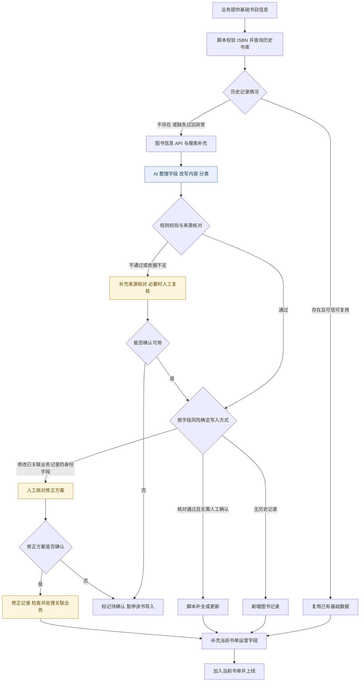

# AI 书单导入｜复用历史数据，处理补全与冲突

**武汉智创未来教育科技有限公司 · AI 产品经理实习 · 2026.01—2026.03**

我独立负责 AI 书单导入这一产品功能，与技术和业务协作，将旧库检索、外部信息补充、AI 内容整理和规则校验连接为半自动工作流，并明确自动更新与人工确认的边界。流程连续运行约 4–5 周，支撑 10+ 批次主题书单上线。

## 1. 问题：书单更新频繁，旧数据又不能直接覆盖

人工逐本补信息、录字段耗时较长。历史书库中存在重复 ISBN、字段缺失与业务引用关系，直接重新抓取和覆盖会影响已有数据；全部重做也会丢掉可复用的信息。

因此，我把流程目标确定为：先识别可信的历史信息，再处理缺失、过旧和异常数据，并明确写入边界。

## 2. 为什么使用 AI：区分规则校验与内容判断

导入需要同时处理字段合规和非结构化资料整理。我将明确的校验条件交给脚本，由 AI 整理字段、改写内容和分类；来源核对后仍有冲突或依据不足的部分进入人工处理。

| 分工 | 处理内容 | 边界 |
| --- | --- | --- |
| 脚本与规则 | ISBN 校验、重复与缺失检查、时效判断、接口检索、字段映射及写入 | 已有明确规则的步骤直接程序化 |
| AI | 非结构化资料整理、内容改写与分类 | 事实字段必须有来源，无法核实的内容保留待确认 |
| 人工 | 尚未消除的冲突、证据不足，以及已关联业务记录的身份字段修改 | 涉及业务关联的身份修改须人工确认 |

## 3. 导入流程：先查旧库，再补数据，核对后写入

蓝色节点为 AI 内容处理，黄色节点为核对与人工处理。

图书信息 API 用于获取结构化基础信息，搜索用于补充缺失和交叉核对。写入方式按下面的字段风险与业务关联确定。

## 4. 更新边界：已有值不等于可以复用

| 字段类型 | 例子 | 处理方式 |
| --- | --- | --- |
| 身份字段 | ISBN 对应的书名、作者 | 冲突先核对来源；修改已关联业务的身份字段须人工确认 |
| 内容字段 | 作者简介等补充内容 | 有依据时补全、整理或纠错，证据不足时待确认 |
| 时效字段 | 价格 | 根据时效要求刷新，不能因为旧库已有值就默认复用 |

早期价格等时效字段可能沿用过旧信息。我进一步拆分身份、内容与时效字段，分别定义复用、补全和更新策略，使流程从“是否有值”推进到“现在是否仍适合复用”。

对于已被书单等业务引用的记录，即使来源已核对清楚，修改书名、作者等身份字段前仍需人工确认。确认后修正记录，并检查关联展示是否正确；未关联业务的记录在冲突消除后按规则更新。

## 5. 结果与复盘

流程连续运行约 4–5 周，支撑 10+ 批次主题书单上线。

这次设计的关键是区分图书基础信息与书单运营信息：书名、作者等字段影响全库及已有引用，主题推荐语与标签则服务当前书单。两类信息需要分别管理，避免一次导入覆盖其他业务正在使用的内容。

[返回作品集首页](00_作品集首页.md) · [查看同段实习的 RAG 答疑案例](09_信奥RAG引导式答疑.md)
