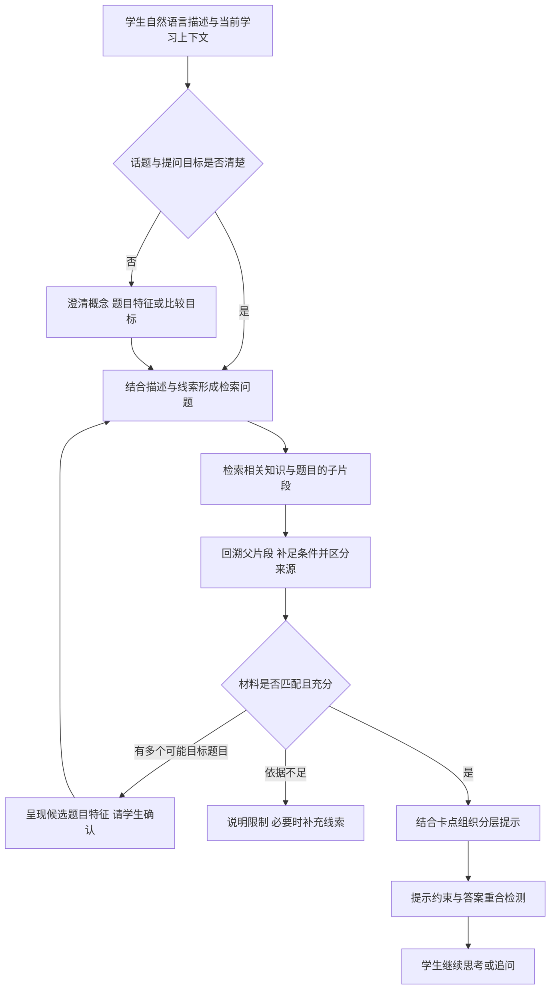

# 信奥 RAG 引导式答疑｜从模糊提问到有依据的学习提示

**武汉智创未来教育科技有限公司 · AI 产品经理实习 · 2026.01—2026.03**

面向公司自研信奥教育平台的课后练习与答疑，我参与 RAG 答疑的产品方案与配置落地，重点设计话题澄清、检索范围和引导式回答，并参与父子分块与召回。功能已供学生实际使用，承接不完整的自然语言描述，找到相关知识与题目，再提供有依据、符合学习目标的提示。

## 1. 项目背景：学生知道自己卡住了，却不一定能说清问题

学生在平台上完成课后练习时，可能只记得“之前有道题也是这样做的”，说不出题号，也不一定知道对应知识点的名称。提问虽然发生在当前题目页面，实际困惑却可能涉及另一道题、某个概念，或两种解法为何不能通用。

因此，产品需要从已有描述出发，在必要时澄清话题，再找到足够支持解释的教学资料。

## 2. 为什么采用 RAG：根据描述找依据，而不依赖学生提供题号

RAG 将学生的自然语言与平台资料建立联系：结合当前学习上下文、问题描述和澄清得到的线索，检索相关知识与题目，再核对适用条件，组织回答。题目 ID 可以辅助定位；缺少题号或标准术语时，仍通过描述与追问形成检索线索，已知题目时也可继续检索相关段落与关联知识。

## 3. 我的工作：从需求定义到答疑方案落地

**需求定义与方案选择。** 将目标明确为帮助学生澄清困惑、找到依据并继续思考。围绕表达不完整、知识点追问与跨题比较的需求，选择“话题澄清＋RAG 检索＋分层提示”的方案，避免答疑只承接当前题目的固定题解。

**对话交互与检索策略设计。** 明确何时可以直接检索、何时需要追问，以及追问要补充什么。概念已清楚时，直接检索对应讲解；需要比较具体题目但指代不清时，询问题目条件、目标或记得的解题方式，用这些线索缩小检索范围。当前页面是理解问题的上下文，不作为所有提问的固定检索边界。

**RAG 方案与配置落地。** 参与父子分块与召回，平衡短问题的匹配精度和解释所需的上下文完整性：先匹配聚焦的子片段，再回溯父片段，补足知识定义、题目条件与推导过程。检索到不同题目的内容时，需要区分来源与适用条件，避免仅因表面相似就混用解法。

**答疑深度与输出边界设计。** 将提示分为知识提醒、思路引导与错误方向提示，随着追问逐步展开；对完整代码、标准答案和缺乏依据的解释设置边界。检索负责提供材料，回答策略负责决定如何使用，不能把“找到题解”直接等同于“向学生展示完整题解”。

答案拦截结合提示约束与输出检测：生成时限制直接给出标准答案，输出时检查答案泄露情况，保留帮助学生继续思考的提示。

## 4. 产品检索逻辑：澄清话题、检索线索、核对依据

## 5. 场景示例：先澄清，再给思考提示（模拟对话）

> 学生：之前那题每次选最大的就行，为什么这题不行？
>
> 助手澄清：你现在是在比较两道题，还是想知道这种选择方法什么时候适用？还记得旧题的目标或条件吗？
>
> 学生：想知道什么时候能这么选，旧题记不清了。
>
> 检索相关概念后给出提示：先想一想，这次选了最大的，会不会让后面的选择变少？可以试一个小规模情况检查。旧题还未定位，暂时不能判断两道题的条件是否相同。

## 6. 测评方案设计

我当时围绕“意图识别与澄清—RAG 检索—分层引导与答案拦截”设计测评。先建立三个环节共用的黄金测评集，再分别规定各环节的操作方法和评价指标，结合完整对话回放检查前后环节能否衔接。

### 测评准备：共用黄金测评集

以 n 组问题与参考答案组织样本，结合教学资料、常见提问和业务规则选题；脚本或模型辅助生成问题及口语改写后，由人工核对问题是否成立、答案是否有据、标注是否完整。每组记录样本 ID、学生提问、已有对话、场景及难度标签，并按环节补充判断依据：

| 环节 | 黄金标注内容 |
| --- | --- |
| 意图识别与澄清 | 目标意图、每轮已知信息、必须补充的条件，以及应追问、可直接检索或应说明限制的预期动作 |
| RAG 检索 | 参考答案要点、相关原文依据、文档与片段 ID、必须同时覆盖的依据及可替代来源、知识库与分块版本 |
| 分层引导与答案拦截 | 学生卡点、合适的提示层级、允许展示的内容、禁止泄露的答案，以及正常提示与应拦截内容的标签 |

参考答案供测评判断使用，学生端仍按分层提示规则输出。每条样本按适用环节标注通过条件；对资料不足、超出支持范围的样本，预期动作可以是澄清或说明限制。

样本覆盖标准问法、口语改写、无题号、信息不足、跨题比较、相似题干但条件不同、需要多个片段、资料未覆盖，以及反复索要完整答案等情形。按以下维度组织覆盖检查：

| 测评维度 | 对应检查 |
| --- | --- |
| 准确性 | 意图、概念、题目条件与引用依据是否正确，是否混用不同题目的解法 |
| 流程结构性 | 是否按需要澄清、检索、核对依据和逐层提示，信息不足时是否走正确分支 |
| 输出风格和价值 | 表达是否符合学生理解水平，提示是否具体、有帮助，是否重复空话 |
| 安全性 | 是否遵守教学要求，能否抵抗诱导其绕过规则、泄露受限内容的请求 |
| 边界性 | 无资料、歧义、跨题及超轮时能否合理收敛，是否承认依据不足 |
| 业务价值性 | 是否帮助学生理解卡点并推进下一步，是否减少无效往返、保留独立思考空间 |

测评集无法穷尽所有 case，因此同时扩大有效样本数量、知识与难度范围、维度和链路分支覆盖。以“场景 × 维度 × 分支”检查缺口，优先补高频与高风险问题，持续将新发现的失败案例纳入回归；同一来源的近似改写不替代新场景。调参集与保留验证集按原题或知识来源分组隔离，避免用同题改写反复调参后高估覆盖。

### 6.1 意图识别与澄清

**操作方法**

1. 从黄金集中选取信息充分、缺少关键条件和超出支持范围的样本，分别明确已有信息、必要条件与预期动作。
2. 将提问和已有对话输入系统，记录意图判断与追问内容；多轮测试按样本设定的学生信息回应追问，保存每轮对话与澄清轮次。
3. 人工逐轮对照黄金标注，检查是否漏问关键条件、重复询问已知内容，或过早确认了错误目标；第三轮结束时检查问题是否已澄清，仍未明确时是否说明缺失条件或引导人工帮助。

**评价指标**

| 指标 | 计算口径 |
| --- | --- |
| 意图识别正确率 | 正确识别目标意图的判断次数 ÷ 有意图标注的判断次数 |
| 漏澄清率 | 应追问却未追问、直接进入针对性处理的次数 ÷ 标注应追问的判断次数 |
| 过澄清率 | 信息充分却仍追问的次数 ÷ 标注无需追问的判断次数，包含重复询问已知信息 |
| 三轮内澄清失败率 | 三轮内未明确正确目标或未补齐必要条件的会话数 ÷ 可判定的澄清会话数 |
| 超三轮澄清率 | 发起第四次及以上澄清追问的会话数 ÷ 已触发澄清的会话数 |

一次追问及学生回应计一轮。没有题号但概念清楚时，不因缺少 ID 而强制追问；学生未回应或材料不足的情况单列，不据此推断澄清成败。

### 6.2 RAG 检索：依据标注与自动化检测

**检索标注**

从共用黄金集中提取检索用例，为每题明确“检索查询—相关片段 ID 集合—必要依据”。一个问题可以对应多个正确片段，跨题比较需要分别标记各题的依据，等价来源注明替代关系。保留文档与原文段落位置、父子片段映射及知识库版本，确保程序比对双方使用相同的片段层级。

**操作方法**

自动化链路设计为“读取检索用例 → 批量请求 Dify → 提取返回片段 → 比对黄金 ID → 计算指标 → 输出逐题与配置报告”。

1. **固定配置跑批**：脚本读取查询及其黄金依据，携带知识库 ID、Top-K、得分阈值与检索配置，批量调用 Dify 知识库检索接口 `POST /v1/datasets/{dataset_id}/retrieve`。检索单测使用已明确意图的标准查询；完整链路测试保留系统澄清、改写后的实际查询。
2. **提取返回片段**：解析 `records` 中的 `segment.id`、`segment.document_id`、内容及 `score`，保留返回顺序；父子模式同时记录 `child_chunks` 与父片段的映射。统一标注与返回结果的片段层级，去除相同 ID 的重复项。接口字段依据见 [Dify 官方接口定义](https://docs.dify.ai/en/api-reference/openapi_service.json)。
3. **自动比对依据**：将前 K 个去重片段与黄金相关片段集合比较，列出命中、漏召回和无关召回的 ID；检查跨题所需依据是否找齐，以及回溯的父片段是否保留必要条件。新出现的合理等价依据经人工复核后统一更新标注。
4. **输出检测报告**：逐题计算以下指标，再按场景、知识点和难度汇总。报告保留样本 ID、黄金 ID、返回 ID／排序／得分、比对明细、指标、耗时和配置版本，供定位问题与比较配置。接口异常单列并按既定重试规则处理，与正常空检索分开记录。

**评价指标**

| 指标 | 计算口径 |
| --- | --- |
| 召回率 Recall@K | 前 K 个去重片段中命中的黄金相关片段数 ÷ 该题全部黄金相关片段数，检查相关依据找回多少 |
| 查准率 Precision@K | 前 K 个去重片段中命中的黄金相关片段数 ÷ K，检查固定检索容量中有多少相关内容；返回不足 K 时缺位按未命中处理，同时记录实际返回数 |

按题计算后取平均，并保留各类样本的数量及分项；黄金相关片段集合为空的无资料题单独检查误召回，不纳入召回率。检索指标口径参考 [Microsoft 信息检索评测](https://learn.microsoft.com/en-us/azure/architecture/ai-ml/guide/rag/rag-information-retrieval#evaluate-your-search-results)。

**配置比较与问题定位**

在同一黄金集上切换 Top-K、得分阈值和分块配置，比较召回覆盖、无关内容与耗时。改变分块时，依据固定原文重新映射片段 ID，保持比较标准一致。根据明细定位资料缺失、切分丢失条件、过滤范围错误、排序靠后或阈值过滤等原因；调整后回归原有案例，并用保留验证集检查泛化表现。

### 6.3 分层引导与答案拦截

**操作方法**

使用黄金集中的学生卡点、参考上下文和提示层级回放答疑，保留拦截前候选与最终输出，由人工核对提示质量、答案泄露与误拦截。引导有效性另结合学生实际解题过程判断，模拟回复或一句“懂了”不作为学习进展的证据。

**评价指标**

- **分层引导成功率**：提示准确、层级合适、能推进且未直接给答案的会话数 ÷ 应引导且可判定的会话数。
- **引导有效率**：经人工核对，学生能解释关键思路、纠错或完成下一步的会话数 ÷ 有后续行为可判定的引导会话数。
- **答案拦截率**：成功阻止或改写且最终未泄露的候选数 ÷ 人工标注应拦截的候选总数，同时检查正常提示误拦截和最终答案泄露。

### 统一复测与回归规则

n 表示不同测评样本的数量；每组从相同初始上下文独立运行 k 次，跨次不共享会话记忆。k 是重复次数，与检索的 Top-K 分开设置。按各样本适用环节的必需条件判断单次是否通过；完整链路回放则检查澄清、检索、提示与拦截是否衔接，先定位最早失效的环节。

- **PASS@k（胜任力）**：k 次中至少一次通过的样本数 ÷ 完成 k 次测试的样本数。
- **PASS^k（稳定性）**：k 次全部通过的样本数 ÷ 完成 k 次测试的样本数。

两者与单次通过表现、分维度失败原因一起看，区分“偶尔能完成”和“稳定完成”；定义参考 [Anthropic 测评说明](https://www.anthropic.com/research/demystifying-evals-for-ai-agents)。n 随覆盖缺口扩充，k 用于观察波动；重复跑同一道题不能替代扩大样本范围。重复测试重点覆盖含模型判断的完整链路，纯检索若在固定配置下结果不变，则以不同查询与场景扩展检查覆盖。回归保留已修复案例与未参与调参的验证样本，未完成或无法判断的试验单列。

[返回作品集首页](00_作品集首页.md) · [查看书单导入工作流](07_AI书单导入工作流.md)
